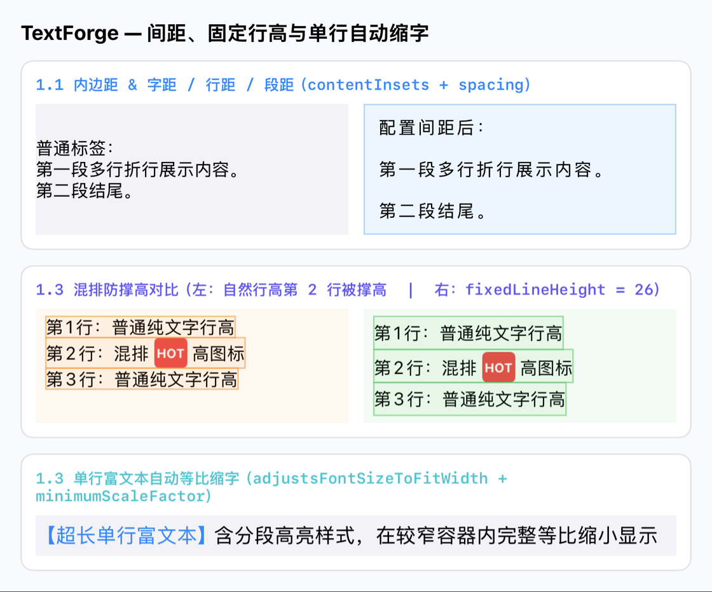
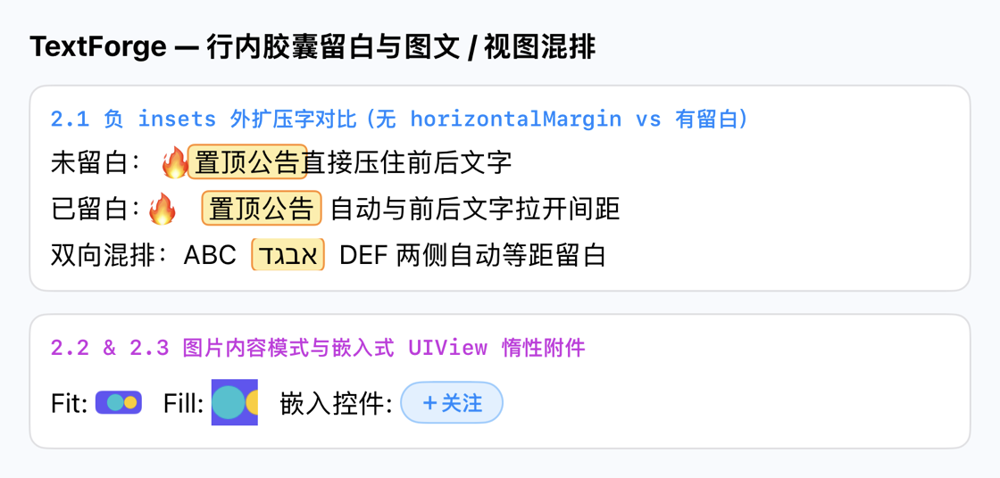
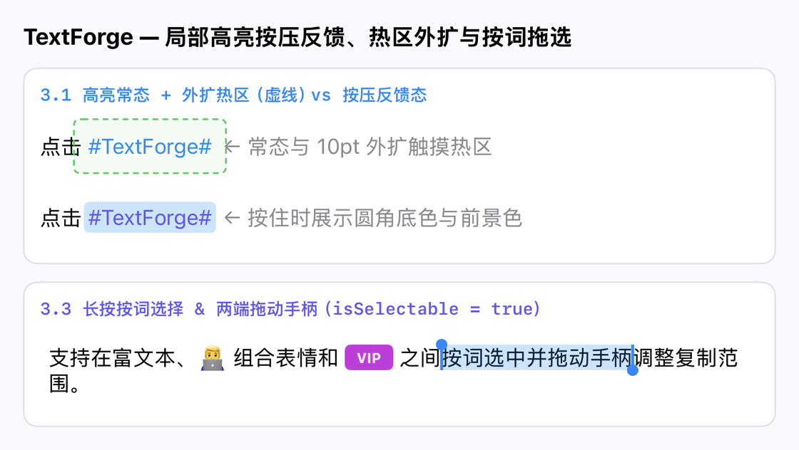
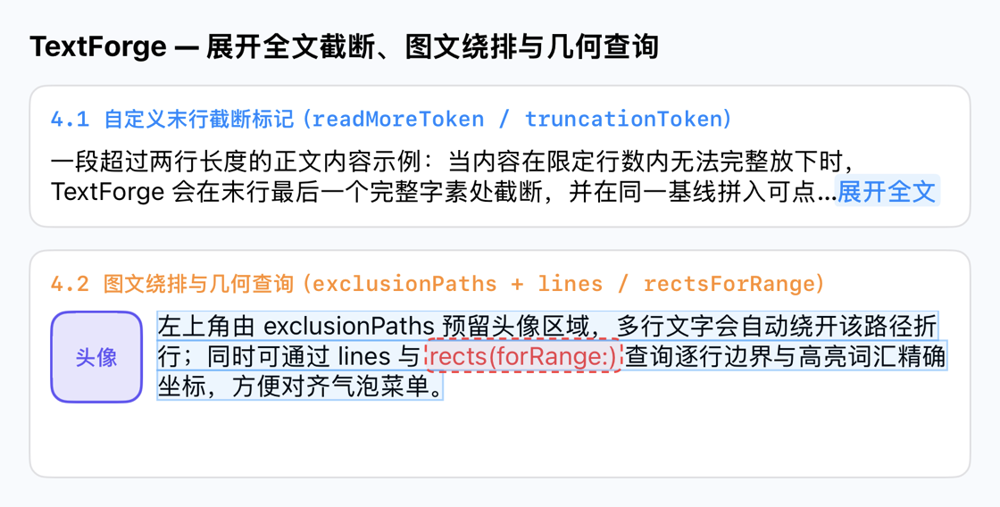
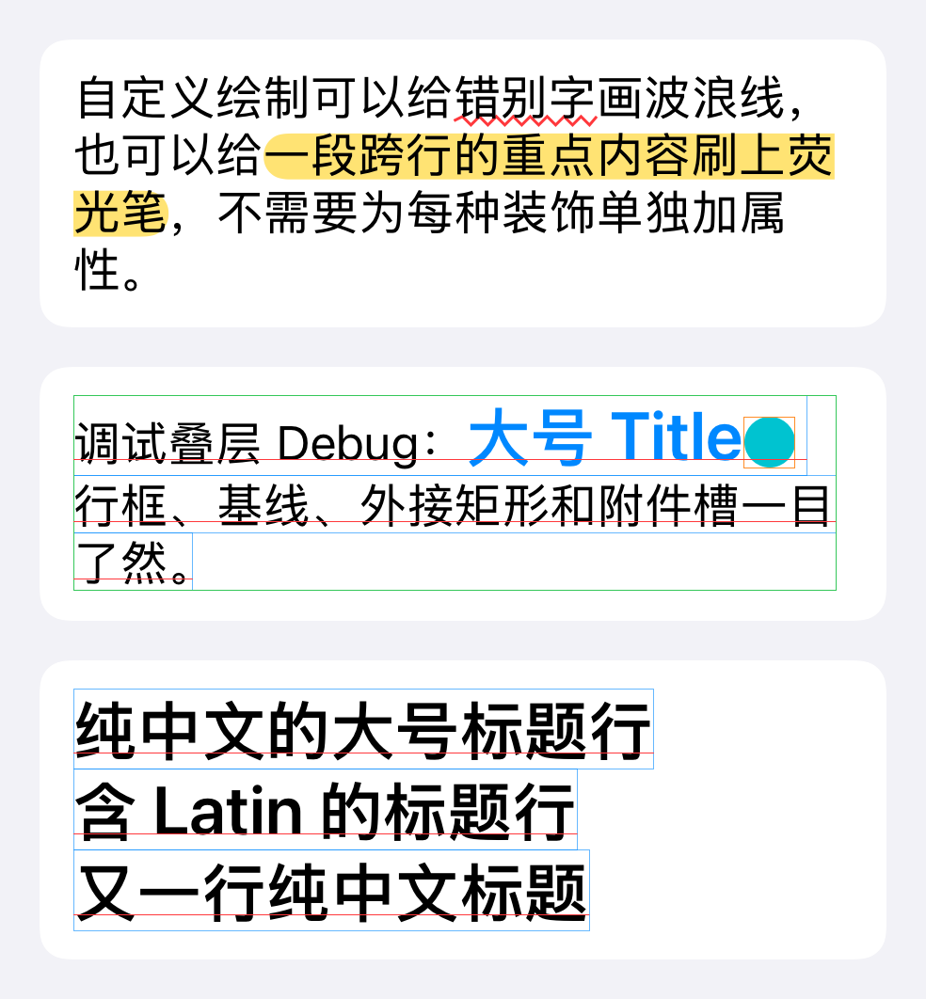
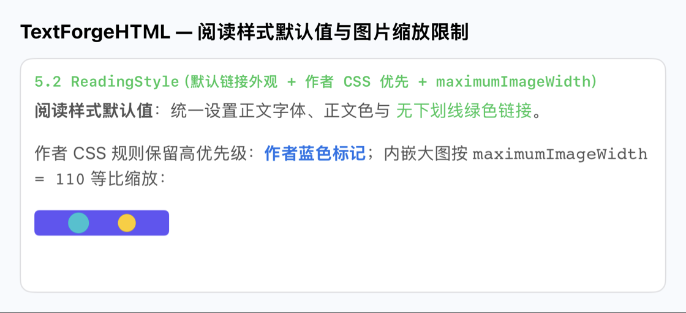
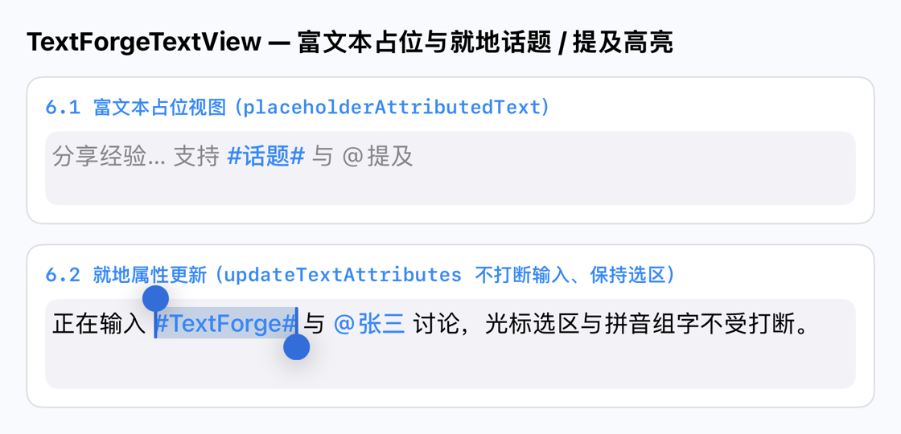

# TextForge

Reusable iOS text rendering and input components for Swift and Objective-C.

TextForge 支持 iOS 15+，基于 UIKit、Foundation、WebKit 与系统 libxml2，为 Swift 与 Objective-C 提供从基础 `UILabel` 替换到富文本混排、交互选区、异步列表缓存、HTML 导入与编辑输入的渐进式解决方案。

> 在主线程创建和更新控件。业务侧的输入规则、字数上限、键盘避让与提交策略由宿主决定。

---

## 按场景速查功能

| 常见需求 | 对应能力 / 核心 API | 查看章节 |
| :--- | :--- | :--- |
| 替换 `UILabel`，控制内边距与字/行/段距 | `TextForgeLabel`、`contentInsets`、`characterSpacing`、`lineSpacing`、`paragraphSpacing` | [1.1 基础间距与内边距](#11-基础间距与内边距) |
| 多字体/表情混排锁死行高、内容垂直对齐、单行与多行自动缩字 | `fixedLineHeight`、`textVerticalAlignment`、`minimumScaleFactor` | [1.2 固定行高对齐与自动缩字](#12-固定行高对齐与自动缩字) |
| 与系统 `UILabel` 行高一致、基线约束对齐，以及仍存在的排版差异 | `firstBaselineAnchor`、`lastBaselineAnchor` | [1.3 与系统 UILabel 的一致性](#13-与系统-uilabel-的一致性) |
| 正文里嵌入图标、徽章、头像并保持比例裁切 | `TextForgeAttachment.image(_:contentMode:size:font:alignment:)` | [2.1 图片附件与内容模式裁切](#21-图片附件与内容模式裁切) |
| 行内嵌入真实按钮/控件，仅进入屏幕时再创建视图 | `TextForgeAttachment.view`、`view(size:font:alignment:provider:)` | [2.2 行内嵌入式视图与惰性加载](#22-行内嵌入式视图与惰性加载) |
| 让附件在复制和 VoiceOver 朗读时转成有意义的文本 | `TextForgeAttachment.withTextAlternatives(_:copyText:accessibilityText:)` | [2.3 附件复制与朗读替代文本](#23-附件复制与朗读替代文本) |
| 生成行内圆角描边标签，自动隔离中英/阿语等双向边界间距 | `TextForgeBackground`、`horizontalMargin`、`apply(to:range:horizontalMargin:)` | [2.4 行内圆角标签与双向间距](#24-行内圆角标签与双向间距) |
| 局部片段点击/长按，扩大过小链接触控热区，VoiceOver 逐个跳转链接 | `TextForgeHighlight`、`highlightTapAction`、`highlightTouchExtensionRadius` | [3.1 局部高亮点击与热区扩大](#31-局部高亮点击与热区扩大) |
| 长按拖选文本、按词/指定区间选中、全选、菜单里加「引用」等自定义项 | `isSelectable`、`allowsCopy`、`selectWord(at:)`、`selectionActions`、`clearsSelectionOnOutsideTap` | [3.2 自由拖选与系统复制菜单](#32-自由拖选与系统复制菜单) |
| 自定义可点击「…展开全文」尾巴并探测是否发生截断 | `truncationToken`、`TextForgeContainer.readMoreToken`、`isTruncated` | [4.1 自定义截断展开标记](#41-自定义截断展开标记) |
| 头像、角标或浮层旁让正文自动文字环绕避让 | `exclusionPaths` | [4.2 文字环绕避让路径](#42-文字环绕避让路径) |
| 离线算高、查逐行基线与字符位置、高亮搜索词视觉片段框 | `TextForgeContainer`、`TextForgeLayout`、`lines`、`characterIndex(at:)`、`rects(forRange:)` | [4.3 容器预排版与几何查询](#43-容器预排版与几何查询) |
| 波浪线、荧光笔、引用竖线等自绘装饰；排查对齐问题时画出行框和基线 | `TextForgeDrawing`、`TextForgeDebugOptions`、`debugOptions` | [4.4 自定义绘制与排版调试](#44-自定义绘制与排版调试) |
| 长文单标签后台预排版与异步光栅化 | `setAttributedTextAsynchronously`、`TextForgeLayout.prepare`、`TextForgeLayoutTask` | [5.1 单控件异步预排版与取消](#51-单控件异步预排版与取消) |
| 滚动列表跨 Cell 复用缓存、冷启动合并与位图/几何预算分离 | `TextForgeListItem`、`TextForgeListLayoutCache` | [5.2 滚动列表跨单元复用缓存](#52-滚动列表跨单元复用缓存) |
| 轻量把 HTML 片段转为 `NSAttributedString` | `TextForgeHTML.attributedString(from:baseURL:completion:)` | [6.1 HTML 轻量异步转换](#61-html-轻量异步转换) |
| HTML 阅读默认样式、作者样式覆盖、宿主图片接管与多图合批刷新 | `TextForgeHTMLReadingStyle`、`TextForgeHTML.importHTML`、`TextForgeHTMLImageUpdate` | [6.2 阅读样式与多图合批导入](#62-阅读样式与多图合批导入) |
| 输入框富文本占位、过滤输入法组字回调与安全就地语法高亮 | `TextForgeTextView`、`placeholderAttributedText`、`onTextChange`、`updateTextAttributes` | [6.3 输入框占位与就地高亮](#63-输入框占位与就地高亮) |
| 输入框限制字数、随内容自动增高到指定行数后滚动 | `maximumTextLength`、`onTextLimitReached`、`minimumNumberOfLines`、`maximumNumberOfLines`、`preferredHeight` | [6.4 字数上限与高度自适应](#64-字数上限与高度自适应) |

---

## Swift Package Manager (SPM) 安装与配置

### 1. Xcode 工程接入

1. 打开消费项目的 `.xcworkspace` 或 `.xcodeproj`，选择 **File → Add Package Dependencies…**（或在 Project → Package Dependencies 点击 **+**）。
2. 在搜索栏输入仓库地址：
   ```text
   https://github.com/HobaoKing/TextForge.git
   ```
3. 选择依赖规则（Dependency Rule）：
   - **生产/团队锁版本（推荐）**：选择 **Exact Version**，填入 `1.0.8`。
   - **自动跟随向后兼容补丁**：选择 **Up to Next Minor Version**，起始版本 `1.0.8`（即 `1.0.8 ..< 1.1.0`）。
   - **特性分支联调**：选择 **Branch**（例如 `master`）。
   - **本地源码联调**：将本地克隆的 `TextForge` 文件夹拖入 Xcode workspace，或通过 **Add Local…** 引入，可直接覆盖同名远程包依赖。
4. 在产品选择页将 **`TextForge`** 添加到实际使用它的 App、Framework 或 Extension target。
5. 建议将 `.xcodeproj` / `.xcworkspace` 与 `Package.resolved` 一并纳入版本控制；若 Xcode 解析缓存异常，可执行 **File → Packages → Reset Package Caches** 后再 **Resolve Package Versions**。

### 2. 在 `Package.swift` 中接入

已有 Swift Package 可直接在 `Package.swift` 声明对 `TextForge` 的依赖，并添加到目标 target：

```swift
// swift-tools-version: 5.9
import PackageDescription

let package = Package(
    name: "MyFeature",
    platforms: [.iOS(.v15)],
    products: [
        .library(name: "MyFeature", targets: ["MyFeature"])
    ],
    dependencies: [
        // 精确锁定版本：
        .package(url: "https://github.com/HobaoKing/TextForge.git", exact: "1.0.8")
        // 或跟随同一主版本内的次版本兼容更新：
        // .package(url: "https://github.com/HobaoKing/TextForge.git", from: "1.0.8")
        // 或本地联调：
        // .package(path: "../TextForge")
    ],
    targets: [
        .target(
            name: "MyFeature",
            dependencies: [
                .product(name: "TextForge", package: "TextForge")
            ]
        )
    ]
)
```

### 3. 构建环境与链接说明

- **最低部署版本**：iOS 15.0+。
- **系统依赖**：`Package.swift` 已自动链接系统 `WebKit.framework` 与 `libxml2.tbd`（`TextForgeHTML` 并在运行期主动引用 `WebKit` 类以兼容开启 `-dead_strip_dylibs` 的宿主），集成方无需手动添加系统库。
- **Objective-C 宿主**：需要在对应 target 的 Build Settings 开启 **Enable Modules (C and Objective-C)**（`CLANG_ENABLE_MODULES = YES`），在 `.m` / `.mm` 文件中通过 `@import TextForge;` 导入，切勿关闭 Swift 头文件导出。
- **版本与发布规则**：SPM 安装版本以 Git 标签为准。自 `1.0.6` 起 Git 标签与 SemVer 版本号一致，Release 标题为 `TextForge <版本号>`。

---

## 阶段一：从零替换 UILabel

仅用几行配置，把原生 `UILabel` 缺少的内边距、统一字/行/段距、固定行高与自动缩字补齐，纯文本与富文本直接共用一套引擎。

### 1.1 基础间距与内边距

- **解决什么问题**：原生 `UILabel` 没有内置 `contentInsets`，纯文本设字距/行距/段距也常常要手拼 `NSMutableParagraphStyle`；`TextForgeLabel` 直接提供统一属性，纯文本和现有 `NSAttributedString` 都能无缝继承。

#### Swift

```swift
import UIKit
import TextForge

func makeBasicLabel() -> TextForgeLabel {
    let label = TextForgeLabel()
    label.font = .systemFont(ofSize: 15)
    label.textColor = .label
    label.numberOfLines = 0
    label.contentInsets = UIEdgeInsets(top: 12, left: 16, bottom: 12, right: 16)
    label.characterSpacing = 0.5
    label.lineSpacing = 6
    label.paragraphSpacing = 10
    label.text = "第一段展示内边距、字距与行距的均衡呼吸感。\n第二段通过 paragraphSpacing 自动拉开段间距离。"
    return label
}

// 如需直接产出包含间距的纯正 NSAttributedString 供第三方控件或离线计算使用：
func makeStyledAttributedText() -> NSAttributedString {
    let raw = NSAttributedString(string: "离线复用同一套字距、行距与段距规则。")
    return TextForgeTypography.styledText(
        raw,
        characterSpacing: 0.5,
        lineSpacing: 6,
        paragraphSpacing: 10
    )
}
```

#### Objective-C

```objc
@import UIKit;
@import TextForge;

static TextForgeLabel *MakeBasicLabel(void) {
    TextForgeLabel *label = [[TextForgeLabel alloc] init];
    label.font = [UIFont systemFontOfSize:15];
    label.textColor = UIColor.labelColor;
    label.numberOfLines = 0;
    label.contentInsets = UIEdgeInsetsMake(12, 16, 12, 16);
    label.characterSpacing = 0.5;
    label.lineSpacing = 6;
    label.paragraphSpacing = 10;
    label.text = @"第一段展示内边距、字距与行距的均衡呼吸感。\n第二段通过 paragraphSpacing 自动拉开段间距离。";
    return label;
}

static NSAttributedString *MakeStyledAttributedText(void) {
    NSAttributedString *raw = [[NSAttributedString alloc] initWithString:@"离线复用同一套字距、行距与段距规则。"];
    return [TextForgeTypography styledText:raw
                          characterSpacing:@(0.5)
                               lineSpacing:@(6)
                          paragraphSpacing:@(10)];
}
```

- **注意事项**：
  - `contentInsets` 同时影响绘制区域、`intrinsicContentSize` 与 `sizeThatFits(_:)`，并与 `textContainerInset` 等价同步。
  - 若 `attributedText` 本身已设置圆角背景 `horizontalMargin`，`TextForgeTypography.styledText` 会在叠加 `characterSpacing` 时保留该水平留白不被覆盖。

---

### 1.2 固定行高对齐与自动缩字

- **解决什么问题**：混排不同字号、大号 Emoji 或多语言文字时，默认行高会被更高字体撑开导致列表视觉参差不齐；`fixedLineHeight` 将每行几何高度锁死为固定点数并按该行字体居中基线。结合 `textVerticalAlignment` 可控制短文本在固定高度控件内的上下位置，`adjustsFontSizeToFitWidth` + `minimumScaleFactor` 则在文本放不下时自动缩字，单行和多行都适用。

#### Swift

```swift
import UIKit
import TextForge

func makeFixedLineHeightLabel() -> TextForgeLabel {
    let label = TextForgeLabel()
    label.numberOfLines = 0
    label.fixedLineHeight = 26
    label.textVerticalAlignment = .top
    label.contentInsets = UIEdgeInsets(top: 10, left: 12, bottom: 10, right: 12)

    let text = NSMutableAttributedString(
        string: "26pt 固定行高混排：",
        attributes: [.font: UIFont.systemFont(ofSize: 15)]
    )
    text.append(NSAttributedString(
        string: "22pt 大号标题",
        attributes: [.font: UIFont.boldSystemFont(ofSize: 22), .foregroundColor: UIColor.systemBlue]
    ))
    text.append(NSAttributedString(
        string: " 🎉 也不会把整行撑塌或贴底。",
        attributes: [.font: UIFont.systemFont(ofSize: 15)]
    ))
    label.attributedText = text
    return label
}

func makeAutoShrinkSingleLineLabel() -> TextForgeLabel {
    let label = TextForgeLabel()
    label.numberOfLines = 1
    label.font = .boldSystemFont(ofSize: 18)
    label.adjustsFontSizeToFitWidth = true
    label.minimumScaleFactor = 0.55
    label.textVerticalAlignment = .center
    label.text = "很长的标题会自动按比例缩小字号以完整展示在同一行内"
    return label
}
```

#### Objective-C

```objc
@import UIKit;
@import TextForge;

static TextForgeLabel *MakeFixedLineHeightLabel(void) {
    TextForgeLabel *label = [[TextForgeLabel alloc] init];
    label.numberOfLines = 0;
    label.fixedLineHeight = 26.0;
    label.textVerticalAlignment = TextForgeVerticalAlignmentTop;
    label.contentInsets = UIEdgeInsetsMake(10, 12, 10, 12);

    NSMutableAttributedString *text = [[NSMutableAttributedString alloc]
        initWithString:@"26pt 固定行高混排："
            attributes:@{ NSFontAttributeName: [UIFont systemFontOfSize:15] }];
    [text appendAttributedString:[[NSAttributedString alloc]
        initWithString:@"22pt 大号标题"
            attributes:@{ NSFontAttributeName: [UIFont boldSystemFontOfSize:22],
                          NSForegroundColorAttributeName: UIColor.systemBlueColor }]];
    [text appendAttributedString:[[NSAttributedString alloc]
        initWithString:@" 🎉 也不会把整行撑塌或贴底。"
            attributes:@{ NSFontAttributeName: [UIFont systemFontOfSize:15] }]];
    label.attributedText = text;
    return label;
}

static TextForgeLabel *MakeAutoShrinkSingleLineLabel(void) {
    TextForgeLabel *label = [[TextForgeLabel alloc] init];
    label.numberOfLines = 1;
    label.font = [UIFont boldSystemFontOfSize:18];
    label.adjustsFontSizeToFitWidth = YES;
    label.minimumScaleFactor = 0.55;
    label.textVerticalAlignment = TextForgeVerticalAlignmentCenter;
    label.text = @"很长的标题会自动按比例缩小字号以完整展示在同一行内";
    return label;
}
```



- **注意事项**：
  - `fixedLineHeight` 在 `TextForgeLabel` 与 `TextForgeContainer` 上均设为 `> 0` 时生效，设为 `0` 恢复自然行高。
  - 自动缩字在 `adjustsFontSizeToFitWidth == true` 且 `minimumScaleFactor < 1` 时生效。单行按宽度缩小；多行（`1.0.8` 起）在限定的行数或高度内放不下全文时等比缩小，缩到 `minimumScaleFactor` 仍放不下就停在该比例并截断。
  - 多行缩字与系统 `UILabel` 一样只发生在按实际边界绘制时：`sizeThatFits(_:)` 和 `intrinsicContentSize` 返回的是未缩小的尺寸。
  - 从 YYText 迁移：用 `YYTextLinePositionModifier` 把每行排在固定间距上的写法（行距取 `字号 × 倍数`），对应 `fixedLineHeight = font.pointSize * 倍数`，`TextForgeLabel` 和 `TextForgeContainer` 上都可以设，总高即 `行数 × fixedLineHeight` 加内边距。区别是 `fixedLineHeight` 把文字在行内上下居中，不需要再手写升部比例。

---

### 1.3 与系统 UILabel 的一致性

`TextForgeLabel` 对普通文本沿用系统 `UILabel` 绘制；用到间距、高亮、链接、附件、选区、点击回调等能力时改用自己的 TextKit 排版。两条路径的目标是同一段文字得到同样的尺寸和位置，这样给标题加一个链接或点击回调不会让列表行高跳动。以下行为在 `1.0.8` 起生效。

- **行高**：系统字体在 20pt 以上排纯中文行时，回退字体的度量比请求字体矮，TextKit 排出的行比 `UILabel` 矮约六分之一，同一段落里纯中文行和含拉丁字符的行也不等高。TextForge 把这样的行补回请求字体的升部和降部，行高、基线与 `UILabel` 一致；`lineHeightMultiple`、`minimumLineHeight`、`maximumLineHeight` 照常生效。回退字体更高的行（如泰文、天城文）保持 TextKit 的结果，不压低。
- **基线约束**：`firstBaselineAnchor`、`lastBaselineAnchor` 以及基线对齐的 `UIStackView` 在自定义排版下与系统路径一致，`contentInsets` 和 `fixedLineHeight` 计入其中。和 `UILabel` 一样，首行基线按文字贴顶计算、末行基线按文字贴底计算，标签被拉得比内容高时两者都不随垂直居中移动。
- **行数与截断**：`.byCharWrapping` 同样遵守 `numberOfLines`；以换行符结尾的文本在行数刚好用完时不再多占一个空行；固定高度的不限行标签在末行放不下时不显示该行，与 `UILabel` 显示的行数相同。

仍然存在的差异：

| 场景 | 表现 | 处理建议 |
| :--- | :--- | :--- |
| 中文标点密集的段落 | `UILabel` 折行时会挤压标点，TextKit 不会，少数宽度下每行容纳的字数不同，偶尔多出或少一行 | 同一列表里的同类标签统一走一条路径；需要与屏幕逐字一致的 `isTruncated`、`characterIndex(at:)` 查询时让标签走自定义排版，例如开启 `isSelectable` |
| 显式赋值 `textLayout` 的标签 | 基线锚点落在标签顶边 | 用 `displayedTextLayout?.lines` 里的 `baseline` 自行建立约束 |
| 多行标签的 `contentInsets` 上下不等 | 基线锚点偏移 `(top - bottom) / 2`，系统路径相同 | 上下内边距取相同值，或改用外层容器留白 |
| 多行标签设置了标签级 `paragraphSpacing` | 基线锚点偏移段距总和的一半 | 把段距写进富文本的段落样式 |
| 泰文、天城文、阿拉伯文等高脚本 | 自定义排版的行比 `UILabel` 高 | 无需处理，文字不会被裁切 |

---

## 阶段二：图文混排与行内标签

当卡片里需要在文字流中穿插图标、真实可交互按钮，或者把「置顶」「精选」渲染成不破坏字符串下标的圆角胶囊标签时，这一组能力可以开箱完成。

### 2.1 图片附件与内容模式裁切

- **解决什么问题**：系统 `NSTextAttachment` 默认直接拉伸或按原图尺寸排版，容易失真且难以对齐文字中心线；`TextForgeAttachment.image` 支持 `.scaleToFill`、`.scaleAspectFit`、`.scaleAspectFill`、`.center` 裁切绘制，并按给定字体基线对齐顶部 / 中心 / 底部。

#### Swift

```swift
import UIKit
import TextForge

@MainActor
func makeImageAttachmentText(icon: UIImage, font: UIFont) -> NSAttributedString {
    let text = NSMutableAttributedString()
    text.append(TextForgeAttachment.image(
        icon,
        contentMode: .scaleAspectFill,
        size: CGSize(width: 24, height: 18),
        font: font,
        alignment: .center
    ))
    text.append(NSAttributedString(string: " 保持 24×18 槽位中心对齐与高分屏清晰度", attributes: [.font: font]))
    return text
}
```

#### Objective-C

```objc
@import UIKit;
@import TextForge;

static NSAttributedString *MakeImageAttachmentText(UIImage *icon, UIFont *font) {
    NSMutableAttributedString *text = [[NSMutableAttributedString alloc] init];
    [text appendAttributedString:[TextForgeAttachment image:icon
                                                contentMode:UIViewContentModeScaleAspectFill
                                                       size:CGSizeMake(24, 18)
                                                       font:font
                                                  alignment:TextForgeVerticalAlignmentCenter]];
    [text appendAttributedString:[[NSAttributedString alloc]
        initWithString:@" 保持 24×18 槽位中心对齐与高分屏清晰度"
            attributes:@{ NSFontAttributeName: font }]];
    return text;
}
```

- **注意事项**：除 `scaleToFill`、`scaleAspectFit`、`scaleAspectFill`、`center` 外，其它 `UIView.ContentMode` 统一按 `center` 处理；槽位内绘制会自动选取当前屏幕及图片最高倍率。

---

### 2.2 行内嵌入式视图与惰性加载

- **解决什么问题**：某些富文本节点不只是静态图标，而是行内可点击的真按钮、动画图标或复选控件，同时长文本里滚出视口外的控件不希望提前分配；`TextForgeAttachment.view` 支持立即传入已有 `UIView`，也支持通过 `provider` 在进入标签可见区域时再按需创建。

#### Swift

```swift
import UIKit
import TextForge

@MainActor
func makeViewAttachmentText(followButton: UIButton, font: UIFont) -> NSAttributedString {
    let text = NSMutableAttributedString(string: "推荐作者 ", attributes: [.font: font])

    // 方式 1：直接嵌入已创建的 UIView
    text.append(TextForgeAttachment.view(
        followButton,
        size: CGSize(width: 58, height: 22),
        font: font,
        alignment: .center
    ))

    text.append(NSAttributedString(string: " 或惰性按视口实例化 ", attributes: [.font: font]))

    // 方式 2：仅当附件滚入标签可见视口时在主线程调用 provider
    text.append(TextForgeAttachment.view(
        size: CGSize(width: 44, height: 20),
        font: font,
        alignment: .center
    ) {
        let badge = UILabel()
        badge.text = "NEW"
        badge.font = .boldSystemFont(ofSize: 11)
        badge.textColor = .white
        badge.backgroundColor = .systemOrange
        badge.textAlignment = .center
        badge.layer.cornerRadius = 4
        badge.layer.masksToBounds = true
        return badge
    })
    return text
}
```

#### Objective-C

```objc
@import UIKit;
@import TextForge;

static NSAttributedString *MakeViewAttachmentText(UIButton *followButton, UIFont *font) {
    NSMutableAttributedString *text = [[NSMutableAttributedString alloc]
        initWithString:@"推荐作者 "
            attributes:@{ NSFontAttributeName: font }];

    [text appendAttributedString:[TextForgeAttachment view:followButton
                                                      size:CGSizeMake(58, 22)
                                                      font:font
                                                 alignment:TextForgeVerticalAlignmentCenter]];

    [text appendAttributedString:[[NSAttributedString alloc]
        initWithString:@" 或惰性按视口实例化 "
            attributes:@{ NSFontAttributeName: font }]];

    [text appendAttributedString:[TextForgeAttachment viewWithSize:CGSizeMake(44, 20)
                                                              font:font
                                                         alignment:TextForgeVerticalAlignmentCenter
                                                          provider:^UIView *{
        UILabel *badge = [[UILabel alloc] init];
        badge.text = @"NEW";
        badge.font = [UIFont boldSystemFontOfSize:11];
        badge.textColor = UIColor.whiteColor;
        badge.backgroundColor = UIColor.systemOrangeColor;
        badge.textAlignment = NSTextAlignmentCenter;
        badge.layer.cornerRadius = 4;
        badge.layer.masksToBounds = YES;
        return badge;
    }]];
    return text;
}
```

- **注意事项**：
  - 立即绑定的单个 `UIView` 同一时刻由当前显示的 `TextForgeLabel` 持有；滚出或迁移复用请优先使用 `provider` 惰性创建。
  - 若富文本含实时 `UIView` 或惰性 `provider`，后台排版与列表缓存会自动安全回退或按条目保留状态，切勿在不同数据条目间共享同一个 `UIView` 实例。

---

### 2.3 附件复制与朗读替代文本

- **解决什么问题**：图文混排内容被用户全选复制到剪切板或由 VoiceOver 朗读时，默认附件位置会变成无意义的 `\u{FFFC}`；`withTextAlternatives` 允许为附件单独指定复制纯文本和无障碍读屏文案。

#### Swift

```swift
import UIKit
import TextForge

@MainActor
func makeAccessibleAttachmentText(icon: UIImage, font: UIFont) -> NSAttributedString {
    let rawBadge = TextForgeAttachment.image(
        icon,
        size: CGSize(width: 18, height: 18),
        font: font,
        alignment: .center
    )
    let badge = TextForgeAttachment.withTextAlternatives(
        rawBadge,
        copyText: "[官方认证]",
        accessibilityText: "官方认证徽章"
    )

    let text = NSMutableAttributedString()
    text.append(badge)
    text.append(NSAttributedString(string: " 产品发布公告", attributes: [.font: font]))

    // 任意时刻可提取整段纯文本用于分享或埋点上报：
    let plainCopy = TextForgeAttachment.copyText(for: text) // "[官方认证] 产品发布公告"
    let spoken = TextForgeAttachment.accessibilityText(for: text) // "官方认证徽章 产品发布公告"
    _ = (plainCopy, spoken)
    return text
}
```

#### Objective-C

```objc
@import UIKit;
@import TextForge;

static NSAttributedString *MakeAccessibleAttachmentText(UIImage *icon, UIFont *font) {
    NSAttributedString *rawBadge = [TextForgeAttachment image:icon
                                                         size:CGSizeMake(18, 18)
                                                         font:font
                                                    alignment:TextForgeVerticalAlignmentCenter];
    NSAttributedString *badge = [TextForgeAttachment attachmentString:rawBadge
                                                             copyText:@"[官方认证]"
                                                    accessibilityText:@"官方认证徽章"];

    NSMutableAttributedString *text = [[NSMutableAttributedString alloc] init];
    [text appendAttributedString:badge];
    [text appendAttributedString:[[NSAttributedString alloc]
        initWithString:@" 产品发布公告"
            attributes:@{ NSFontAttributeName: font }]];

    NSString *plainCopy = [TextForgeAttachment copyTextForAttributedString:text];
    NSString *spoken = [TextForgeAttachment accessibilityTextForAttributedString:text];
    (void)plainCopy;
    (void)spoken;
    return text;
}
```

- **注意事项**：`TextForgeLabel` 复制与 `TextForgeTextView.accessibilityValue` 会自动读取这些替代文案。

---

### 2.4 行内圆角标签与双向间距

- **解决什么问题**：把正文中的「置顶」「精选」变成圆角填充+描边胶囊时，传统做法往字符串里塞空格会污染复制结果、破坏后端下发下标，在双向混排（如 `ABC אבגד DEF`）边界还容易错位。`TextForgeBackground` 的 `horizontalMargin` 仅在渲染层与双向边界自动保留水平间隔，不增加字符长度。

#### Swift

```swift
import UIKit
import TextForge

func makePillAttributedText() -> NSAttributedString {
    let text = NSMutableAttributedString(
        string: "置顶精选 ABC אבגד DEF",
        attributes: [.font: UIFont.systemFont(ofSize: 15)]
    )

    let topTag = TextForgeBackground(fillColor: UIColor.systemBlue.withAlphaComponent(0.12), cornerRadius: 5)
    topTag.strokeColor = .systemBlue
    topTag.strokeWidth = 1
    topTag.insets = UIEdgeInsets(top: 1, left: 5, bottom: 1, right: 5)
    // horizontalMargin 自动在相邻文字边界留出 6pt 外边距，不改 UTF-16 下标
    topTag.apply(to: text, range: NSRange(location: 0, length: 2), horizontalMargin: 6)

    let rtlWord = TextForgeBackground(fillColor: UIColor.systemPurple.withAlphaComponent(0.12), cornerRadius: 4)
    rtlWord.insets = UIEdgeInsets(top: 1, left: 4, bottom: 1, right: 4)
    rtlWord.apply(to: text, range: NSRange(location: 9, length: 4), horizontalMargin: 4)
    return text
}
```

#### Objective-C

```objc
@import UIKit;
@import TextForge;

static NSAttributedString *MakePillAttributedText(void) {
    NSMutableAttributedString *text = [[NSMutableAttributedString alloc]
        initWithString:@"置顶精选 ABC אבגד DEF"
            attributes:@{ NSFontAttributeName: [UIFont systemFontOfSize:15] }];

    TextForgeBackground *topTag = [[TextForgeBackground alloc]
        initWithFillColor:[UIColor.systemBlueColor colorWithAlphaComponent:0.12]
             cornerRadius:5];
    topTag.strokeColor = UIColor.systemBlueColor;
    topTag.strokeWidth = 1.0;
    topTag.insets = UIEdgeInsetsMake(1, 5, 1, 5);
    [topTag applyTo:text range:NSMakeRange(0, 2) horizontalMargin:6.0];

    TextForgeBackground *rtlWord = [[TextForgeBackground alloc]
        initWithFillColor:[UIColor.systemPurpleColor colorWithAlphaComponent:0.12]
             cornerRadius:4];
    rtlWord.insets = UIEdgeInsetsMake(1, 4, 1, 4);
    [rtlWord applyTo:text range:NSMakeRange(9, 4) horizontalMargin:4.0];
    return text;
}
```



- **注意事项**：
  - `insets` 控制背景/边框相对字形本身的上下左右扩展；`horizontalMargin` 控制背景外沿与前后相邻非同背景字形之间的隔离距离。
  - 若需要描边，`strokeWidth` 与 `strokeColor` 须同时设置。

---

## 阶段三：交互与选区

在可视化富文本上补全点击、长按按压反馈、微链接热区扩增、按词/拖选高亮手柄、系统复制菜单与 VoiceOver 无障碍自定义动作。

### 3.1 局部高亮点击与热区扩大

- **解决什么问题**：新闻摘要、协议条款里的短链接区域很小，手指容易点空；并且点击时常需要背景高亮、文字变色以及按压圆角，外加区分普通区域点击与具体片段回调。

#### Swift

```swift
import UIKit
import TextForge

func configureInteractiveHighlight(on label: TextForgeLabel) {
    let raw = "请阅读 《用户协议》 后继续操作"
    let text = NSMutableAttributedString(string: raw, attributes: [
        .font: UIFont.systemFont(ofSize: 15),
        .foregroundColor: UIColor.label
    ])
    let range = (raw as NSString).range(of: "《用户协议》")

    let highlight = TextForgeHighlight(
        color: .systemBlue,
        backgroundColor: UIColor.systemBlue.withAlphaComponent(0.18)
    )
    highlight.highlightedTextColor = .systemIndigo
    highlight.cornerRadius = 5
    highlight.backgroundInsets = UIEdgeInsets(top: -2, left: -3, bottom: -2, right: -3)
    highlight.userInfo = ["route": "terms"]
    highlight.tapAction = { _, attrText, hitRange, _ in
        print("点击协议：", attrText.attributedSubstring(from: hitRange).string)
    }
    highlight.apply(to: text, range: range)

    label.attributedText = text
    // 将链接附近可响应点击的热区向四周扩宽 10pt（含贴边窄按钮场景）
    label.highlightTouchExtensionRadius = 10
    label.highlightLongPressAction = { _, attrText, hitRange, rect in
        print("长按高亮：", attrText.attributedSubstring(from: hitRange).string, rect)
    }
    label.textTapAction = { _, _, _, _ in
        print("点击了非高亮区域")
    }
}
```

#### Objective-C

```objc
@import UIKit;
@import TextForge;

static void ConfigureInteractiveHighlight(TextForgeLabel *label) {
    NSString *raw = @"请阅读 《用户协议》 后继续操作";
    NSMutableAttributedString *text = [[NSMutableAttributedString alloc]
        initWithString:raw
            attributes:@{ NSFontAttributeName: [UIFont systemFontOfSize:15],
                          NSForegroundColorAttributeName: UIColor.labelColor }];
    NSRange range = [raw rangeOfString:@"《用户协议》"];

    TextForgeHighlight *highlight = [[TextForgeHighlight alloc]
        initWithColor:UIColor.systemBlueColor
      backgroundColor:[UIColor.systemBlueColor colorWithAlphaComponent:0.18]];
    highlight.highlightedTextColor = UIColor.systemIndigoColor;
    highlight.cornerRadius = 5;
    highlight.backgroundInsets = UIEdgeInsetsMake(-2, -3, -2, -3);
    highlight.userInfo = @{ @"route": @"terms" };
    highlight.tapAction = ^(UIView *container, NSAttributedString *attrText, NSRange hitRange, CGRect rect) {
        NSLog(@"点击协议：%@", [attrText attributedSubstringFromRange:hitRange].string);
    };
    [highlight applyTo:text range:range];

    label.attributedText = text;
    label.highlightTouchExtensionRadius = 10.0;
    label.highlightLongPressAction = ^(UIView *container, NSAttributedString *attrText, NSRange hitRange, CGRect rect) {
        NSLog(@"长按高亮：%@", [attrText attributedSubstringFromRange:hitRange].string);
    };
    label.textTapAction = ^(UIView *container, NSAttributedString *attrText, NSRange hitRange, CGRect rect) {
        NSLog(@"点击了非高亮区域");
    };
}
```

- **注意事项**：
  - 优先派发命中的 `highlight.tapAction`（若为 `nil` 则走标签统一的 `highlightTapAction`），否则当落点命中文本外沿或普通文字时走 `textTapAction`。
  - 系统 `.link` 属性会自动使用 `linkTextAttributes` 渲染并同样被识别为高亮，同时暴露给 VoiceOver 的 `accessibilityCustomActions`。
  - 可见且可点击的高亮和链接还会进入 VoiceOver 的「链接」转子（`1.0.8` 起）：用户可在转子里逐个跳转，焦点框落在链接自己的位置，双击等同点击。标签本身仍作为一个整体朗读，宿主设置的其他 `accessibilityCustomRotors` 保留。

---

### 3.2 自由拖选与系统复制菜单

- **解决什么问题**：评论或动态文本常允许用户长按选词、拖动左右手柄自由扩选并弹出系统「拷贝」菜单；业务端也可能需要通过代码直接选中某词（如检索定位）或感知复制菜单的显隐状态。

#### Swift

```swift
import UIKit
import TextForge

func configureSelectableLabel(_ label: TextForgeLabel) {
    label.font = .systemFont(ofSize: 15)
    label.numberOfLines = 0
    label.text = "支持长按按词选中、拖动手柄微调选区，以及弹出系统复制菜单。"
    label.isSelectable = true
    label.allowsCopy = true
    label.copyMenuVisibilityHandler = { visible in
        print("复制菜单状态：", visible ? "已展示" : "已隐藏")
    }
}

func programmaticSelect(_ label: TextForgeLabel) {
    // 1) 按指定 UTF-16 范围选中并弹起手柄
    label.selectText(in: NSRange(location: 4, length: 4))
    // 2) 或者按触摸坐标按词选中：
    // label.selectWord(at: CGPoint(x: 80, y: 20))
    print("当前选中文案：", label.selectedText ?? "")
    // 清空选区：label.clearSelection()
}
```

#### Objective-C

```objc
@import UIKit;
@import TextForge;

static void ConfigureSelectableLabel(TextForgeLabel *label) {
    label.font = [UIFont systemFontOfSize:15];
    label.numberOfLines = 0;
    label.text = @"支持长按按词选中、拖动手柄微调选区，以及弹出系统复制菜单。";
    label.isSelectable = YES;
    label.allowsCopy = YES;
    label.copyMenuVisibilityHandler = ^(BOOL visible) {
        NSLog(@"复制菜单状态：%@", visible ? @"已展示" : @"已隐藏");
    };
}

static void ProgrammaticSelect(TextForgeLabel *label) {
    [label selectTextInRange:NSMakeRange(4, 4)];
    NSLog(@"当前选中文案：%@", label.selectedText ?: @"");
    // 按坐标选词：[label selectWordAtPoint:CGPointMake(80, 20)];
    // 清空选区：[label clearSelection];
}
```



- **注意事项**：
  - `allowsCopy` 独立控制是否响应整段长按拷贝；开启 `isSelectable = true` 后，即使未单独设置 `allowsCopy`，也可通过手柄选区弹出复制菜单。
  - 若选中范围跨越了附件，复制内容自动使用 `withTextAlternatives` 指定的 `copyText`。

以下选区能力在 `1.0.8` 起提供。

```swift
// 菜单里接在系统操作之后的自定义项（iOS 16 起显示）。回调拿到选区文案和原文 UTF-16 范围，选区保持不变。
label.selectionActions = [
    TextForgeSelectionAction(title: "引用") { label, text, range in
        quote(text)
        label.clearSelection()
    }
]
// 标签外有按钮要读取 selectedText 时关掉点外清除，否则点按钮的同一下触摸会先清掉选区。
label.clearsSelectionOnOutsideTap = false
```

```objc
label.selectionActions = @[
    [[TextForgeSelectionAction alloc] initWithTitle:@"引用" handler:^(TextForgeLabel *source, NSString *text, NSRange range) {
        Quote(text);
        [source clearSelection];
    }]
];
label.clearsSelectionOnOutsideTap = NO;
```

  - 有选区时点到标签以外的地方会清除选区（`clearsSelectionOnOutsideTap` 默认开启）。标签只旁观这次点击，不拦截触摸，滚动列表不受影响。
  - 选区没有占满时菜单提供「全选」，选中选区所在的整段连续可见正文；被省略号或「…全文」隐藏的部分不会被选中。
  - 用 `frame` 或 `bounds` 改变标签尺寸都会清除选区。
  - `selectionActions` 在 iOS 15 上不显示，系统的拷贝和全选仍然可用。

---

## 阶段四：复杂排版

用于解决截断展开、异形文字绕排、以及算高 / 逐行基线 / 搜索词边框等精准排版控制。

### 4.1 自定义截断展开标记

- **解决什么问题**：系统 `UILabel` 的省略号只是一段静态字符；而实际 Feeds 流经常要求末行显示高对比的 `…展开全文` 按钮，点击后立即切换到完整正文，并能准确判断当前内容是否真的被截断。

#### Swift

```swift
import UIKit
import TextForge

func configureReadMoreLabel(_ label: TextForgeLabel, onExpand: @escaping () -> Void) {
    label.numberOfLines = 3
    label.lineBreakMode = .byTruncatingTail
    label.truncationToken = TextForgeContainer.readMoreToken(title: "…展开全文") { _, _, _, _ in
        onExpand()
    }
    label.text = "这是一段用于演示多行收起与展开的长文本内容，当超过三行高度时，末行末尾会自动替换为可点击的「…展开全文」标记。"

    // 布局完成后可直接核查：
    // label.isTruncated / label.showsTruncationToken / label.truncationTokenRect
}
```

#### Objective-C

```objc
@import UIKit;
@import TextForge;

static void ConfigureReadMoreLabel(TextForgeLabel *label, dispatch_block_t onExpand) {
    label.numberOfLines = 3;
    label.lineBreakMode = NSLineBreakByTruncatingTail;
    label.truncationToken = [TextForgeContainer readMoreTokenWithTitle:@"…展开全文"
                                                                action:^(UIView *view, NSAttributedString *text, NSRange range, CGRect rect) {
        if (onExpand) { onExpand(); }
    }];
    label.text = @"这是一段用于演示多行收起与展开的长文本内容，当超过三行高度时，末行末尾会自动替换为可点击的「…展开全文」标记。";
}
```

- **注意事项**：`truncationToken` 需配合 `numberOfLines > 0`（或 `TextForgeContainer.maximumNumberOfRows > 0`）及会产生尾部截断的 `lineBreakMode`（如 `.byTruncatingTail`）使用。

---

### 4.2 文字环绕避让路径

- **解决什么问题**：卡片左上角放头像、右上角放推荐徽章或浮层角标时，正文不能盖住元素，而是沿着指定矩形/圆角路径自然避让排版。

#### Swift

```swift
import UIKit
import TextForge

func configureExclusionLabel(_ label: TextForgeLabel) {
    label.numberOfLines = 0
    label.font = .systemFont(ofSize: 15)
    label.contentInsets = UIEdgeInsets(top: 10, left: 12, bottom: 10, right: 12)
    // 预留左上角 64×64 圆角头像占位区域（坐标相对于标签布局区）
    let avatarHole = UIBezierPath(roundedRect: CGRect(x: 12, y: 10, width: 64, height: 64), cornerRadius: 12)
    label.exclusionPaths = [avatarHole]
    label.text = "文本流在避让左上角 64×64 圆角区域后会自动绕排其右侧空间，超出头像底部后再恢复整行宽排布。"
}
```

#### Objective-C

```objc
@import UIKit;
@import TextForge;

static void ConfigureExclusionLabel(TextForgeLabel *label) {
    label.numberOfLines = 0;
    label.font = [UIFont systemFontOfSize:15];
    label.contentInsets = UIEdgeInsetsMake(10, 12, 10, 12);
    UIBezierPath *avatarHole = [UIBezierPath bezierPathWithRoundedRect:CGRectMake(12, 10, 64, 64)
                                                          cornerRadius:12];
    label.exclusionPaths = @[avatarHole];
    label.text = @"文本流在避让左上角 64×64 圆角区域后会自动绕排其右侧空间，超出头像底部后再恢复整行宽排布。";
}
```

- **注意事项**：若同时配置了 `truncationToken` 且末尾行被 `exclusionPaths` 收窄，引擎仍会结合剩余行宽安全保留截断标记，不会退化回流。

---

### 4.3 容器预排版与几何查询

- **解决什么问题**：需要把高度计算从 UI 控件里抽离出来做数据源预先算高，或者定位某个关键词在界面中的跨行矩形、查询用户点中的字符下标、`lines` 每行范围和基线位置。

#### Swift

```swift
import UIKit
import TextForge

@MainActor
func precomputeLayoutAndInspect(attributedText: NSAttributedString, maxWidth: CGFloat) -> TextForgeLayout {
    let container = TextForgeContainer(size: CGSize(width: maxWidth, height: 400))
    container.insets = UIEdgeInsets(top: 10, left: 12, bottom: 10, right: 12)
    container.maximumNumberOfRows = 4
    container.fixedLineHeight = 22

    let layout = TextForgeLayout(container: container, attributedText: attributedText)
    print("文本总尺寸：", layout.textBoundingSize, "行数：", layout.rowCount)

    for line in layout.lines {
        print("第 \(line.row) 行 range=\(line.range) rect=\(line.rect) baseline=\(line.baseline)")
    }

    // 查询关键词视觉碎片边框（跨行或双向混排会拆为多个矩形）
    let keywordRange = (attributedText.string as NSString).range(of: "TextForge")
    if keywordRange.location != NSNotFound {
        let fragmentRects = layout.rects(forRange: keywordRange)
        print("关键词碎片矩形：", fragmentRects)
    }

    // 把点击坐标映射回原文 UTF-16 下标
    let index = layout.characterIndex(at: CGPoint(x: 40, y: 20))
    _ = index
    return layout
}
```

#### Objective-C

```objc
@import UIKit;
@import TextForge;

static TextForgeLayout *PrecomputeLayoutAndInspect(NSAttributedString *attributedText, CGFloat maxWidth) {
    TextForgeContainer *container = [[TextForgeContainer alloc] initWithSize:CGSizeMake(maxWidth, 400)];
    container.insets = UIEdgeInsetsMake(10, 12, 10, 12);
    container.maximumNumberOfRows = 4;
    container.fixedLineHeight = 22.0;

    TextForgeLayout *layout = [[TextForgeLayout alloc] initWithContainer:container attributedText:attributedText];
    NSLog(@"文本总尺寸：%@ 行数：%ld", NSStringFromCGSize(layout.textBoundingSize), (long)layout.rowCount);

    for (TextForgeLine *line in layout.lines) {
        NSLog(@"第 %ld 行 range=%@ rect=%@ baseline=%.2f",
              (long)line.row, NSStringFromRange(line.range), NSStringFromCGRect(line.rect), line.baseline);
    }

    NSRange keywordRange = [attributedText.string rangeOfString:@"TextForge"];
    if (keywordRange.location != NSNotFound) {
        NSArray<NSValue *> *fragmentRects = [layout rectsForRange:keywordRange];
        NSLog(@"关键词碎片矩形数：%lu", (unsigned long)fragmentRects.count);
    }

    NSInteger index = [layout characterIndexAtPoint:CGPointMake(40, 20)];
    (void)index;
    return layout;
}
```



- **注意事项**：生成完 `TextForgeLayout` 后，直接赋给 `label.textLayout = layout` 可跳过控件内部二次排版；设为 `nil` 则重新使用控件自身属性。

---

### 4.4 自定义绘制与排版调试

- **解决什么问题**：波浪下划线、荧光笔、引用竖线这类装饰各不相同，逐个做成内置属性做不完。`TextForgeDrawing` 把一段文字在每一行的排版矩形交给宿主自己画；`TextForgeDebugOptions` 则在排查对齐、行高和附件位置时把行框、基线、外接矩形和附件槽直接画在标签上。两者在 `1.0.8` 起提供。

#### Swift

```swift
import UIKit
import TextForge

func applyMarker(to text: NSMutableAttributedString, range: NSRange) {
    // 跨行时每行回调一次；isFirst / isLast 标明整段的首段和末段，用来决定圆头画在哪一侧。
    let marker = TextForgeDrawing { context, rect, isFirst, isLast in
        var corners: UIRectCorner = []
        if isFirst { corners.formUnion([.topLeft, .bottomLeft]) }
        if isLast { corners.formUnion([.topRight, .bottomRight]) }
        let path = UIBezierPath(roundedRect: rect.insetBy(dx: 0, dy: 2), byRoundingCorners: corners,
                                cornerRadii: CGSize(width: 6, height: 6))
        context.setFillColor(UIColor.systemYellow.withAlphaComponent(0.55).cgColor)
        context.addPath(path.cgPath)
        context.fillPath()
    }
    marker.apply(to: text, range: range)
}

func enableLayoutDebugging(for label: TextForgeLabel) {
    label.debugOptions = .standard()            // 只调试这一个标签
    // TextForgeDebugOptions.shared = .standard()  // 或者对之后创建、赋值的全部标签生效
}
```

#### Objective-C

```objc
@import UIKit;
@import TextForge;

static void ApplyMarker(NSMutableAttributedString *text, NSRange range) {
    TextForgeDrawing *marker = [[TextForgeDrawing alloc] initWithHandler:^(CGContextRef context, CGRect rect, BOOL isFirst, BOOL isLast) {
        CGContextSetFillColorWithColor(context, [UIColor.systemYellowColor colorWithAlphaComponent:0.55].CGColor);
        CGContextFillRect(context, CGRectInset(rect, 0, 2));
    }];
    [marker applyTo:text range:range];
}

static void EnableLayoutDebugging(TextForgeLabel *label) {
    label.debugOptions = [TextForgeDebugOptions standard];
    // TextForgeDebugOptions.shared = [TextForgeDebugOptions standard];
}
```



- **注意事项**：
  - 回调在主线程执行，`rect` 横向是这段文字的字形范围，纵向是基线上下的字体升部与降部，不含行距；坐标可直接用于当前图形上下文。
  - 默认画在文字之下、`TextForgeBackground` 之上；`drawsAboveText = true` 改为画在文字之上。绘制超出 `rect` 时把最大外伸量写进 `outset`，局部重绘才不会漏画。
  - 含 `TextForgeDrawing` 的文本交给 `TextForgeLayout.prepare` 或列表缓存时会退回主线程同步排版，不生成预绘位图。
  - 需要指定线宽和位置的下划线可以直接用 `TextForgeDrawing.underline(color:width:offset:)`（Objective-C 为 `underlineWithColor:width:offset:`），线画在文字底边之下 `offset` 点处；只需要颜色时用系统的 `.underlineStyle` 加 `.underlineColor` 即可。
  - 调试叠层的四种颜色各自可以为 `nil`；开启后标签改用自己的排版绘制，画出的线与文字位置一致。`shared` 对已经显示的标签不会立刻生效，重新赋一次内容即可。

---

## 阶段五：异步绘制与列表缓存

针对包含长文本与高频快速滑动的 Feed 流，提供后台分离预排版与跨 Cell/跨等价内容的缓存管理。

### 5.1 单控件异步预排版与取消

- **解决什么问题**：详情页或公告卡片如果正文很长，直接在主线程同步计算与光栅化易引发掉帧；`setAttributedTextAsynchronously` / `TextForgeLayout.prepare` 将可后台化的排版及预渲染推入后台队列，返回 `TextForgeLayoutTask` 以便重用或滑出时立刻取消。

#### Swift

```swift
import UIKit
import TextForge

final class FeedCardCell: UITableViewCell {
    private let contentLabel = TextForgeLabel()
    private var currentTask: TextForgeLayoutTask?

    override func prepareForReuse() {
        super.prepareForReuse()
        currentTask?.cancel()
        currentTask = nil
    }

    func bind(attributedText: NSAttributedString, targetWidth: CGFloat) {
        currentTask?.cancel()
        contentLabel.numberOfLines = 0
        currentTask = contentLabel.setAttributedTextAsynchronously(
            attributedText,
            size: CGSize(width: targetWidth, height: .greatestFiniteMagnitude),
            rendersAsynchronously: true
        ) {
            // 仅当任务未取消且宽度仍匹配时才会主线程交付到控件
            print("异步排版与预绘完成")
        }
    }
}
```

#### Objective-C

```objc
@import UIKit;
@import TextForge;

@interface FeedCardCell : UITableViewCell
@property (nonatomic, strong) TextForgeLabel *contentLabel;
@property (nonatomic, strong, nullable) TextForgeLayoutTask *currentTask;
@end

@implementation FeedCardCell

- (void)prepareForReuse {
    [super prepareForReuse];
    [self.currentTask cancel];
    self.currentTask = nil;
}

- (void)bindAttributedText:(NSAttributedString *)attributedText targetWidth:(CGFloat)targetWidth {
    [self.currentTask cancel];
    self.contentLabel.numberOfLines = 0;
    self.currentTask = [self.contentLabel setAttributedTextAsynchronously:attributedText
                                                                     size:CGSizeMake(targetWidth, CGFLOAT_MAX)
                                                    rendersAsynchronously:YES
                                                               completion:^{
        NSLog(@"异步排版与预绘完成");
    }];
}

@end
```

- **注意事项**：当正文或截断标记内包含实时 `UIView` 等无法脱离主线程的属性时，`TextForgeLayout.prepare` 会自动在内部安全退回主线程排版，调用侧无需手动兜底判断。

---

### 5.2 滚动列表跨单元复用缓存

- **解决什么问题**：长列表中既有数据源 `prefetch`，又有 Cell 渲染时的即时绑定，还常出现多条数据正文外观完全相同（各自只带不同点击回调）的情况；`TextForgeListLayoutCache` 对**内容等价项共享同一份度量、引擎和位图结果**同时保留各自回调不串包，并把纯几何条目上限（`layoutCountLimit`）与位图内存字节预算（`bitmapByteLimit`）独立分开——哪怕位图被系统提前回收，几何布局和行高仍然秒命中。

#### Swift

```swift
import UIKit
import TextForge

@MainActor
final class FeedLayoutManager {
    // 16MB 位图缓存上限 + 128 条纯几何缓存上限
    let cache = TextForgeListLayoutCache(bitmapByteLimit: 16 * 1024 * 1024, layoutCountLimit: 128)
    private var tasks: [IndexPath: TextForgeLayoutTask] = [:]

    func makeItem(attributedText: NSAttributedString, width: CGFloat) -> TextForgeListItem {
        let container = TextForgeContainer(size: CGSize(width: width, height: .greatestFiniteMagnitude))
        container.maximumNumberOfRows = 4
        return TextForgeListItem(attributedText: attributedText, container: container)
    }

    // 在 prefetchRowsAt 调用预排版与预绘
    func prefetch(item: TextForgeListItem, indexPath: IndexPath, size: CGSize, traits: UITraitCollection) {
        tasks[indexPath]?.cancel()
        tasks[indexPath] = cache.prepare(
            item,
            size: size,
            renderScale: max(1, traits.displayScale),
            traitCollection: traits
        ) { _ in }
    }

    // 在 cellForRowAt 绑定（已驻留缓存同步命中，未命中则发起异步补充）
    func bind(_ label: TextForgeLabel, item: TextForgeListItem, size: CGSize, traits: UITraitCollection) -> TextForgeLayoutTask? {
        if let layout = cache.cachedLayout(for: item, size: size, renderScale: max(1, traits.displayScale), traitCollection: traits)
            ?? cache.cachedLayout(for: item, size: size, traitCollection: traits) {
            label.textLayout = layout
            return nil
        }
        return cache.prepare(item, size: size, renderScale: max(1, traits.displayScale), traitCollection: traits) { [weak label] layout in
            label?.textLayout = layout
        }
    }
}
```

#### Objective-C

```objc
@import UIKit;
@import TextForge;

@interface FeedLayoutManager : NSObject
@property (nonatomic, strong) TextForgeListLayoutCache *cache;
@end

@implementation FeedLayoutManager

- (instancetype)init {
    self = [super init];
    if (self) {
        _cache = [[TextForgeListLayoutCache alloc] initWithBitmapByteLimit:16 * 1024 * 1024 layoutCountLimit:128];
    }
    return self;
}

- (TextForgeLayoutTask * _Nullable)bindLabel:(TextForgeLabel *)label
                                        item:(TextForgeListItem *)item
                                        size:(CGSize)size
                                      traits:(UITraitCollection *)traits {
    CGFloat scale = MAX(1.0, traits.displayScale);
    TextForgeLayout *layout = [self.cache cachedLayoutForItem:item size:size renderScale:scale traitCollection:traits]
        ?: [self.cache cachedLayoutForItem:item size:size traitCollection:traits];
    if (layout) {
        label.textLayout = layout;
        return nil;
    }
    __weak typeof(label) weakLabel = label;
    return [self.cache prepareItem:item size:size renderScale:scale traitCollection:traits completion:^(TextForgeLayout *ready) {
        weakLabel.textLayout = ready;
    }];
}

@end
```

- **注意事项**：
  - `TextForgeListItem` 代表一份不可变内容版本。若文案、高亮回调或容器配置发生变化，请重新实例化新的 `TextForgeListItem`（不要直接改动旧项里的字符串内容）。
  - 可用 `cache.cachedSize(for:size:traitCollection:)` 在 `heightForRowAt` 直接读取缓存尺寸。

---

## 阶段六：HTML 导入与 TextForgeTextView 编辑器

分别覆盖“动态文章正文 HTML 转原生富文本”与“中文输入法友好富文本编辑器”两类高阶场景。

### 6.1 HTML 轻量异步转换

- **解决什么问题**：仅需把后端返回的小段 HTML 片段安全地转为 `NSAttributedString`，希望规避 WebKit 在主线程阻塞启动或静态链下 `-dead_strip_dylibs` 裁剪分类的问题。

#### Swift

```swift
import UIKit
import TextForge

@MainActor
func loadSimpleHTML(into label: TextForgeLabel) {
    let html = "<p>这是 <b>粗体</b> 与 <a href='https://example.com'>标准链接</a> 片段。</p>"
    TextForgeHTML.attributedString(from: html, baseURL: nil) { attributed, error in
        guard let attributed, error == nil else { return }
        label.attributedText = attributed
    }
}
```

#### Objective-C

```objc
@import UIKit;
@import TextForge;

static void LoadSimpleHTMLIntoLabel(TextForgeLabel *label) {
    NSString *html = @"<p>这是 <b>粗体</b> 与 <a href='https://example.com'>标准链接</a> 片段。</p>";
    __weak typeof(label) weakLabel = label;
    [TextForgeHTML attributedStringFromHTML:html baseURL:nil completion:^(NSAttributedString *attributed, NSError *error) {
        if (!attributed || error) { return; }
        weakLabel.attributedText = attributed;
    }];
}
```

- **注意事项**：完成回调保证在主线程执行；在表格复用控件赋值前请自行校验该内容是否仍归属于当前列表条目。

---

### 6.2 阅读样式与多图合批导入

- **解决什么问题**：长文章 HTML 的系统默认样式（字体太小、蓝色下划线链接、超宽图片撑爆排版）很难直接融进 App 风格；且同时加载 10 张插图若每到一张就全量重排会导致画面不停跳动。`TextForgeHTMLReadingStyle` 通过零优先级规则设定默认风格（不覆盖作者自带的显式 CSS，如 `.tag`），配合 `imageLoader` 接管宿主图片缓存并对同 URL 请求去重，再用 `imageUpdate`（`TextForgeHTMLImageUpdate`）按主队列合批交付变更位置与 `didChangeSize` 标记。

#### Swift

```swift
import UIKit
import TextForge

@MainActor
func importRichArticleHTML(html: String, label: TextForgeLabel) -> TextForgeHTMLImportTask {
    let style = TextForgeHTMLReadingStyle()
    style.defaultFont = .systemFont(ofSize: 15)
    style.textColor = .label
    style.linkColor = .systemGreen
    style.underlinesLinks = false
    style.maximumImageWidth = 280
    style.placeholderSize = CGSize(width: 24, height: 24)

    return TextForgeHTML.importHTML(
        html,
        baseURL: nil,
        readingStyle: style,
        imageLoader: { url, deliver in
            // 接管宿主网络/缓存，返回可选取消闭包
            let task = URLSession.shared.dataTask(with: url) { data, _, _ in
                let image = data.flatMap(UIImage.init(data:))
                deliver(image)
            }
            task.resume()
            return { task.cancel() }
        },
        imageUpdate: { [weak label] update in
            // update.isInitial 先交付占位快照；多张图片就绪后合批刷新，可用 update.didChangeSize 决定是否重新算高
            label?.attributedText = update.attributedText
        },
        completion: { [weak label] finalText, error in
            if let finalText, error == nil {
                label?.attributedText = finalText
            }
        }
    )
}
```

#### Objective-C

```objc
@import UIKit;
@import TextForge;

static TextForgeHTMLImportTask *ImportRichArticleHTML(NSString *html, TextForgeLabel *label) {
    TextForgeHTMLReadingStyle *style = [[TextForgeHTMLReadingStyle alloc] init];
    style.defaultFont = [UIFont systemFontOfSize:15];
    style.textColor = UIColor.labelColor;
    style.linkColor = UIColor.systemGreenColor;
    style.underlinesLinks = @(NO);
    style.maximumImageWidth = 280;
    style.placeholderSize = CGSizeMake(24, 24);

    __weak typeof(label) weakLabel = label;
    return [TextForgeHTML importHTML:html
                             baseURL:nil
                        readingStyle:style
                         imageLoader:^dispatch_block_t (NSURL *url, void (^deliver)(UIImage *image)) {
        NSURLSessionDataTask *task = [NSURLSession.sharedSession dataTaskWithURL:url
                                                               completionHandler:^(NSData *data, NSURLResponse *resp, NSError *err) {
            UIImage *image = data ? [UIImage imageWithData:data] : nil;
            deliver(image);
        }];
        [task resume];
        return ^{ [task cancel]; };
    } imageUpdate:^(TextForgeHTMLImageUpdate *update) {
        weakLabel.attributedText = update.attributedText;
    } completion:^(NSAttributedString *finalText, NSError *error) {
        if (finalText && !error) {
            weakLabel.attributedText = finalText;
        }
    }];
}
```



- **注意事项**：
  - 随时调用 `task.cancel()` 会终止尚未完成的宿主图片请求，且取消后不会再交付任何占位更新或 `completion`。
  - 宿主接管的图片按 `width`、`height` 属性或内联样式里的像素值占位。内联样式写的是百分比、`auto` 等相对值时沿用属性里的像素值（`1.0.8` 起；此前会连属性值一并丢掉，图片加载后才跳到正确尺寸）。

---

### 6.3 输入框占位与就地高亮

- **解决什么问题**：原生 `UITextView` 没有自带占位提示；更棘手的是中文输入法在拼音组字阶段会持续发出 `textViewDidChange`，极易误触发即时检索或计数弹窗，而在 `textViewDidChange` 里直接改 `attributedText` 上色又常导致选区跳乱或组字打断。`TextForgeTextView` 内建纯/富文本占位，精准只在已提交正文变化时回调 `onTextChange`，并提供可在代理内部安全执行的就地属性刷新 `updateTextAttributes(_:)`。

#### Swift

```swift
import UIKit
import TextForge

final class ComposerViewController: UIViewController, UITextViewDelegate {
    private let textView = TextForgeTextView()

    override func viewDidLoad() {
        super.viewDidLoad()
        textView.font = .systemFont(ofSize: 16)
        textView.placeholderAttributedText = NSAttributedString(
            string: "说点什么（支持 #话题# 与 @提及 高亮）",
            attributes: [.foregroundColor: UIColor.placeholderText, .font: UIFont.systemFont(ofSize: 16)]
        )
        textView.delegate = self
        textView.onTextChange = { committedText in
            // 跳过中文/日文等 IME 拼音组字中间态，仅在已上屏正文变化时触发；兼容粘贴/剪切与代理截断
            print("已提交全文：", committedText)
        }
    }

    func textViewDidChange(_ textView: UITextView) {
        guard let editor = textView as? TextForgeTextView else { return }
        // 1) 非组字态字数截断（截断恢复原值时不会重复触发 onTextChange）
        if editor.markedTextRange == nil, editor.text.count > 200 {
            editor.text = String(editor.text.prefix(200))
        }
        // 2) 安全在编辑代理内就地刷亮 #话题# / @提及，不破坏当前选区也不额外触发 onTextChange
        editor.updateTextAttributes { mutable in
            let full = NSRange(location: 0, length: mutable.length)
            mutable.addAttribute(.foregroundColor, value: UIColor.label, range: full)
            let regex = try? NSRegularExpression(pattern: "(#[^#\\s]+#|@[\\p{Han}A-Za-z0-9_]+)")
            regex?.enumerateMatches(in: mutable.string, range: full) { match, _, _ in
                if let range = match?.range {
                    mutable.addAttribute(.foregroundColor, value: UIColor.systemBlue, range: range)
                }
            }
        }
    }
}
```

#### Objective-C

```objc
@import UIKit;
@import TextForge;

@interface ComposerViewController : UIViewController <UITextViewDelegate>
@property (nonatomic, strong) TextForgeTextView *textView;
@end

@implementation ComposerViewController

- (void)viewDidLoad {
    [super viewDidLoad];
    self.textView = [[TextForgeTextView alloc] init];
    self.textView.font = [UIFont systemFontOfSize:16];
    self.textView.placeholderAttributedText = [[NSAttributedString alloc]
        initWithString:@"说点什么（支持 #话题# 与 @提及 高亮）"
            attributes:@{ NSForegroundColorAttributeName: UIColor.placeholderTextColor,
                          NSFontAttributeName: [UIFont systemFontOfSize:16] }];
    self.textView.delegate = self;
    self.textView.onTextChange = ^(NSString *committedText) {
        NSLog(@"已提交全文：%@", committedText);
    };
}

- (void)textViewDidChange:(UITextView *)textView {
    if (![textView isKindOfClass:TextForgeTextView.class]) { return; }
    TextForgeTextView *editor = (TextForgeTextView *)textView;
    if (editor.markedTextRange == nil && editor.text.length > 200) {
        editor.text = [editor.text substringToIndex:200];
    }
    [editor updateTextAttributes:^(NSMutableAttributedString *mutableText) {
        NSRange full = NSMakeRange(0, mutableText.length);
        [mutableText addAttribute:NSForegroundColorAttributeName value:UIColor.labelColor range:full];
        NSRegularExpression *regex = [NSRegularExpression
            regularExpressionWithPattern:@"(#[^#\\s]+#|@[\\p{Han}A-Za-z0-9_]+)" options:0 error:nil];
        [regex enumerateMatchesInString:mutableText.string options:0 range:full
                            usingBlock:^(NSTextCheckingResult *result, NSMatchingFlags flags, BOOL *stop) {
            [mutableText addAttribute:NSForegroundColorAttributeName value:UIColor.systemBlueColor range:result.range];
        }];
    }];
}

@end
```



- **注意事项**：`updateTextAttributes(_:)` 仅允许修改属性而不能改变字符码元；处于组字状态（`markedTextRange != nil`）或发生字符变更时将返回 `false` 并自动保护输入法状态，待候选词上屏并清空标记文本后可立即正常染色。

---

### 6.4 字数上限与高度自适应

- **解决什么问题**：限制字数通常要在 `textView:shouldChangeTextInRange:replacementText:` 里手写长度判断，还得用 `markedTextRange` 避开拼音组字，稍有疏漏就会把输入中的拼音截断或拆开表情。评论框、聊天输入栏则需要随内容增高、到几行后改为滚动。两项能力在 `1.0.8` 起提供。

#### Swift

```swift
import UIKit
import TextForge

func configureCommentInput(_ input: TextForgeTextView, counter: UILabel) {
    input.maximumTextLength = 200
    input.onTextChange = { text in
        counter.text = "\((text as NSString).length)/200"
    }
    input.onTextLimitReached = {
        showToast("最多输入 200 个字")
    }

    // 1 行起步，最多 5 行，之后在框内滚动。自动布局下不需要高度约束。
    input.minimumNumberOfLines = 1
    input.maximumNumberOfLines = 5
    // 用 frame 布局时在这里更新高度：
    input.onPreferredHeightChange = { [weak input] height in
        input?.frame.size.height = height
    }
}
```

#### Objective-C

```objc
@import UIKit;
@import TextForge;

static void ConfigureCommentInput(TextForgeTextView *input, UILabel *counter) {
    input.maximumTextLength = 200;
    input.onTextChange = ^(NSString *text) {
        counter.text = [NSString stringWithFormat:@"%lu/200", (unsigned long)text.length];
    };
    input.onTextLimitReached = ^{
        ShowToast(@"最多输入 200 个字");
    };

    input.minimumNumberOfLines = 1;
    input.maximumNumberOfLines = 5;
    __weak TextForgeTextView *weakInput = input;
    input.onPreferredHeightChange = ^(CGFloat height) {
        CGRect frame = weakInput.frame;
        frame.size.height = height;
        weakInput.frame = frame;
    };
}
```

- **注意事项**：
  - 字数按 `NSString` 的 UTF-16 长度计，与 `text.length` 一致：一个汉字计 1，多数表情计 2 或更多。超出时截掉的是本次新输入里放不下的部分，原有文字和光标位置不变；放不下一个完整的表情时整个去掉。
  - 粘贴同样处理：粘贴到中间或替换选区时，截掉的是粘贴内容的尾部，前后原有文字不动，光标停在保留下来的粘贴内容之后。粘贴几万字只做一次线性比较。
  - 拼音组字期间不截断，候选字上屏后再处理。直接给 `text`、`attributedText` 赋值不受上限约束；这样赋进来的正文已经超过上限时，用户不能再加长，但可以删除和缩短。
  - 发生截断时：`onTextChange` 只收到截断后的正文；宿主的 `textViewDidChange:` 会先收到一次超长的正文、再收到一次截断后的正文，计数显示建议放在 `onTextChange` 里；撤销记录会被清空。
  - 一次粘贴很多行时，高度直接到最多行数并滚到光标处。正文很长时建议设置 `maximumNumberOfLines`：有上限时每次按键只看开头一段就能判断，只设最少行数则每次都要量全文。
  - 高度自适应在两个行数都为 0 时关闭。开启后由输入框接管 `isScrollEnabled`，`preferredHeight` 含上下 `textContainerInset`，按当前宽度计算，宽度变化后自动更新。

## 独立示例与自动化验证

[`Examples/Swift`](Examples/Swift) 与 [`Examples/ObjectiveC`](Examples/ObjectiveC) 分别提供引用根目录 Swift Package 的独立 Xcode 工程，可直接打开运行查看。

可以通过仓库内的验证脚本在已启动的 iOS 模拟器上自动编译 `TextForge`、Swift 与 Objective-C 示例工程并运行端到端行为断言：

```bash
bash scripts/verify-ios.sh booted
# 或指定具体模拟器 UDID：
# bash scripts/verify-ios.sh <booted-simulator-udid>
```

单元测试用 XCTest 编写，放在 [`Tests/TextForgeTests`](Tests/TextForgeTests)，同样在模拟器上运行，不需要宿主 App：

```bash
bash scripts/test-ios.sh booted
# 等价于：xcodebuild test -scheme TextForge -destination 'platform=iOS Simulator,id=<UDID>'
```

单元测试覆盖与系统 `UILabel` 的逐行像素对照（行高、段落样式、限行与限高）、多行缩字、基线锚点、选区收起与菜单扩展、VoiceOver 链接转子、自定义绘制和调试叠层、HTML 图片的声明尺寸，以及输入框的字数上限和高度自适应。

示例脚本验证覆盖：内边距与图文测量、字/行/段距与固定行高对齐、圆角胶囊与双向混排水平间距、附件内容模式 Retina 缩放、按视口惰性实例化 `UIView` 附件、链接热区外扩、排除路径防末行回流、按词拖选与手柄绘制、长按拷贝菜单、VoiceOver 自定义操作、HTML 阅读样式及多图批更新、滚动列表等价 `TextForgeListItem` 并发复用与预算分离，以及 `TextForgeTextView` 在第一响应者下的组字/粘贴/剪切裁剪和 `updateTextAttributes` 就地刷新。

---

## License

TextForge 采用 [Apache License 2.0](LICENSE) 开源许可。
